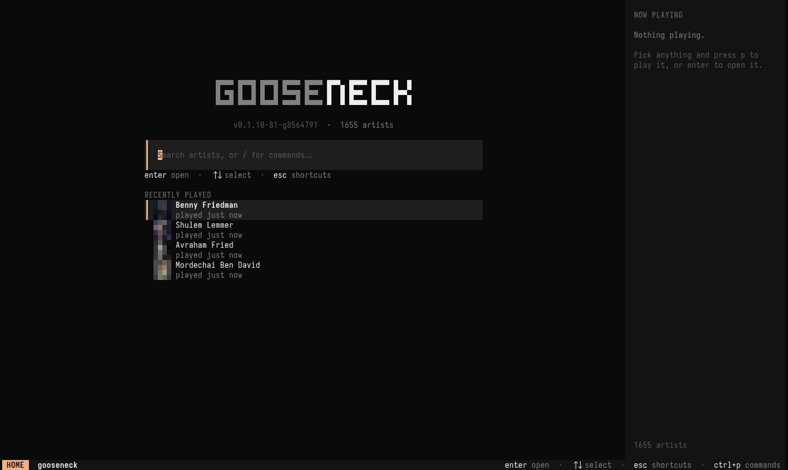

# gooseneck

**Jewish music in your terminal.** A curated catalog of ~1650 artists, a
full-screen TUI in the style of [OpenCode](https://opencode.ai), and a CLI that
can do everything the TUI can — browse discographies, queue albums, and control
playback from any shell, script or keybinding.

[](https://github.com/lubabs770/gooseneck/actions/workflows/build-player.yml)



- **Instant discographies** — albums, singles & EPs, top songs, bios and
  related artists straight from YouTube Music, cached locally (works offline once
  visited).
- **A real player** — gooseneck runs `mpv` as a small background daemon:
  pause, skip, seek, volume, repeat, shuffle, play-next, and a queue. Music keeps
  playing after you close the TUI, and every terminal controls the same player.
- **Looks good** — painted theme layers, 14 themes with live preview, a command
  palette, artist pictures and album art (real images on Kitty/Ghostty, colour
  half-block art everywhere else).
- **Offline** — download a track, album or whole artist with yt-dlp
  (`goose download`, or `D` in the TUI); downloaded tracks play from disk.
- **Scrobbling** — always to a private local log (`goose scrobbles`, stats,
  export), and optionally to ListenBrainz and/or Last.fm, by real listening
  time, even after the TUI is closed; offline listens are queued.
- **Your desktop's theme** — on Omarchy it follows the current theme, live.
- **Fully scriptable** — every action is a `goose` command with `--json`
  output and shell completion for artist and album names.

## Install

```sh
curl -fsSL https://raw.githubusercontent.com/lubabs770/gooseneck/main/install.sh | sh
```

Installs **`gooseneck-player`** and the short alias **`goose`** to
`~/.local/bin` (override with `BIN_DIR=`, pin with `VERSION=vX.Y.Z`). Windows:
grab the `.exe` from the [releases page](https://github.com/lubabs770/gooseneck/releases).

Needs **[mpv](https://mpv.io)** and **[yt-dlp](https://github.com/yt-dlp/yt-dlp)**.
Run `goose doctor` to check everything.

## The TUI

Run `goose`. Start typing to search, `enter` to open, `p` to play.

| Key | Action |
|-----|--------|
| `hjkl` / arrows | move · `enter` open (or play from here) · `esc` back |
| `/` | search / filter the current page |
| `tab` | next section (artist page) or tag (library) |
| `p` `a` `A` `s` | play · add to queue · play next · shuffle |
| `P` `S` | play / shuffle everything by this artist |
| `space` `n` `N` | pause · next · previous |
| `[` `]` · `{` `}` | seek ∓10s · ∓60s |
| `-` `+` · `r` | volume · repeat (off → all → one) |
| `D` | download the selection for offline play |
| `m` | endless radio from the selected artist |
| `1`–`5` | home · library · queue · history · downloads |
| `ctrl+p` | command palette (also `/` commands from the home prompt) |
| `t` · `v` · `i` · `b` | themes · grid/list · art on/off · sidebar |
| `?` · `q` | help · quit (music keeps playing; `goose stop` stops it) |

**Themes.** On [Omarchy](https://omarchy.org) gooseneck wears your desktop
theme automatically: the `omarchy` theme reads the current Omarchy theme's
`colors.toml` and repaints **live** when you switch themes with
`omarchy theme set` (no restart). Everywhere else the default is `opencode`.
Built-in palettes: `opencode`, `ayu`, `catppuccin`, `dracula`, `everforest`,
`gruvbox`, `kanagawa`, `latte`, `matrix`, `mono`, `nord`, `onedark`,
`rosepine`, `tokyonight`, and `system` (your terminal's own colours). Press `t`
for a live-preview picker, or `goose config set theme <name>`; `auto` goes back
to following Omarchy. The CLI's colours follow the same theme.

## The CLI


```sh
goose search fried                        # fuzzy artist search (--tag chasidish, -n 5)
goose artist "8th Day"                    # albums, singles, top songs, related
goose album "8th Day" lucky               # tracklist (title, fragment, or number)
goose play "8th Day" lucky                # play an album
goose play "8th Day" lucky 3              # …starting from track 3
goose play fried --shuffle                # everything by an artist, shuffled
goose play "8th Day" --top --add          # append their top songs to the queue
goose play https://youtu.be/<id>          # any single video
goose now | queue | next | prev | pause | resume | toggle | stop
goose seek +30 | seek 1:15 | vol 60 | vol -10 | repeat all | shuffle
goose queue jump 4 | queue rm 2 | queue clear
goose radio "8th Day"                     # endless radio: artist + related artists
goose radio | radio stop                  # what's on / end it
goose download "8th Day" lucky            # save an album for offline play
goose download fried --top                # …or an artist's top songs
goose downloads | downloads rm "8th Day" lucky
goose history | top | tags | artists --tag israeli
goose catalog update | cache warm --tag famous | doctor
goose config set theme tokyonight
```

Every listing takes `--json`. A few things that are now one-liners:

```sh
# status bar module (waybar, polybar, tmux…): empty output when nothing plays
goose now --format '{title} — {artist}'

# pick an artist with fzf and play them
goose artists | fzf | xargs -I{} goose play {}

# media keys / window-manager bindings
goose toggle     # play/pause
goose next

# latest album of an artist
goose artist "Avraham Fried" --json | jq -r '.albums[0].title'
```

Shell completion (artist and album names complete too):
`goose completion zsh > "${fpath[1]}/_goose"` (also `bash`, `fish`, `powershell`).

## Scrobbling

```sh
goose scrobble login listenbrainz     # paste your token from listenbrainz.org/settings
goose scrobble login lastfm           # approve gooseneck in your browser (see below)
goose scrobble                        # status: services, current track, queue
goose scrobble off | on | flush | logout lastfm
```

Every listen that counts is also written to a **local scrobble log** — its own
SQLite file, `~/.config/gooseneck/scrobbles.db` (`scrobble_db` to move it,
`local_scrobble = false` to turn it off) — no account needed:

```sh
goose scrobbles -s today                  # recent listens
goose scrobbles top artist -s month       # also: track, album
goose scrobbles stats -s year             # listens, time, artists, days
goose scrobbles export --format listenbrainz > listens.json   # importable later
goose scrobbles export --format csv > listens.csv
```

The TUI's history page (`4`) has a **Listens** tab with the same log.

A small background daemon (it also runs radio) starts with playback and exits
when the player does, so listens count whether or not the TUI is open. It uses Last.fm's
rules: a track counts after half its length or 4 minutes of *actual*
listening (pauses and seeking don't count), and tracks under 30 seconds never
count. "Now playing" is sent too, and the TUI sidebar shows when the current
track will scrobble. Listens that can't be sent (offline, service down) are
queued in the database and retried.

Last.fm makes every app use an API key: create one at
<https://www.last.fm/api/account/create> (free; the callback URL can stay
empty) and pass it once with `goose scrobble login lastfm --key … --secret …`.
Credentials live in the config file, which gooseneck writes with mode `0600`
and masks in `goose config` output.

## Config

`~/.config/gooseneck/config.toml` is written on first run. Edit it, or use
`goose config set <key> <value>`:

```toml
theme        = "auto"         # auto = Omarchy's theme if installed, else opencode
view         = "grid"         # grid | list
thumbnails   = true           # artist / album art
thumb_height = 0              # art height in rows; 0 = auto
sidebar      = true           # now-playing sidebar on wide terminals
show_help    = true           # key hints in the status bar
volume       = 80             # starting volume
player       = "mpv"          # other players work fire-and-forget ($APP overrides)
player_args  = ["--no-video"]
local_scrobble = true         # record listens in scrobble_db
scrobble_db  = ""             # "" = ~/.config/gooseneck/scrobbles.db
bin_dir      = ""             # directory holding yt-dlp; "" = $PATH
download_dir = ""             # "" = ~/Music/gooseneck/<Artist>/<Album>/
artists_json = ""             # use your own catalog file
artists_url  = "https://skmusic.shalomkarr.workers.dev/data/artists.json"
```

`GOOSENECK_HOME=/some/dir` moves config, cache and the player socket somewhere
else (handy for testing). `GOOSENECK_IMAGES=kitty|halfblock|off` forces an image
mode.

## How it works

- **Catalog** — [`artists.json`](artists.json) (~1650 artists with tags such as
  Chasidish, Israeli, A cappella) is refreshed daily by a GitHub Action
  ([`fetch-artists.yml`](.github/workflows/fetch-artists.yml)). The player
  downloads it on first run; `goose catalog update` refreshes it.
- **Music data** — artist and album pages come from YouTube Music's web API (one
  request each, ~0.5s), cached in SQLite (`~/.config/gooseneck/cache.db`).
  Channels without a YouTube Music page fall back to a `yt-dlp` uploads listing.
- **Playback** — the first play starts `mpv --idle` with an IPC socket in
  `$XDG_RUNTIME_DIR/gooseneck/`; the TUI and every `goose` command talk to it.
  Audio is streamed by mpv's yt-dlp hook.
- **Radio** — `goose radio <artist>` (or `m`) queues a mix of the artist and
  related catalog artists, then the background daemon keeps topping the queue
  up as it runs low, drifting through related artists and never repeating a
  track in the session. Playing something else, `goose radio stop`, or
  shutting the player down ends it.
- **Downloads** — `yt-dlp` saves the best audio (m4a when available, tagged
  when ffmpeg is installed) as `<Artist>/<Album>/NN - Title [id].m4a`. Every
  play checks for a local copy first, so downloaded music works offline and
  starts instantly. Re-running a download only fetches what's missing.
- **Media keys** — install [mpv-mpris](https://github.com/hoyon/mpv-mpris)
  and the daemon shows up in desktop media controls / `playerctl` automatically
  (`goose doctor` tells you if it's there).
- **History** — every play is recorded (`goose history`, `goose top`), and
  the home screen shows recently played artists.

## Build from source

```sh
cd player
go build -o gooseneck-player .
go vet ./... && go test ./...
```

Go 1.23+, no cgo. CI ([`build-player.yml`](.github/workflows/build-player.yml))
tests and cross-compiles linux/macOS/windows × amd64/arm64 on every change and
publishes a release for `v*` tags. Architecture notes for contributors (and AI
agents) are in [`LLM.md`](LLM.md).

The GIFs above are recorded with [VHS](https://github.com/charmbracelet/vhs)
against an isolated, pre-warmed demo home (your own config and history never
appear):

```sh
demo/setup.sh && vhs demo/tui.tape && vhs demo/cli.tape
```

## Roadmap

- **Multiple catalogs** — a personal `artists.json` alongside the main one.
- **Windows playback control** — mpv's named-pipe IPC (Windows plays, but
  fire-and-forget for now).
- **Lyrics** in the sidebar where YouTube Music has them.
